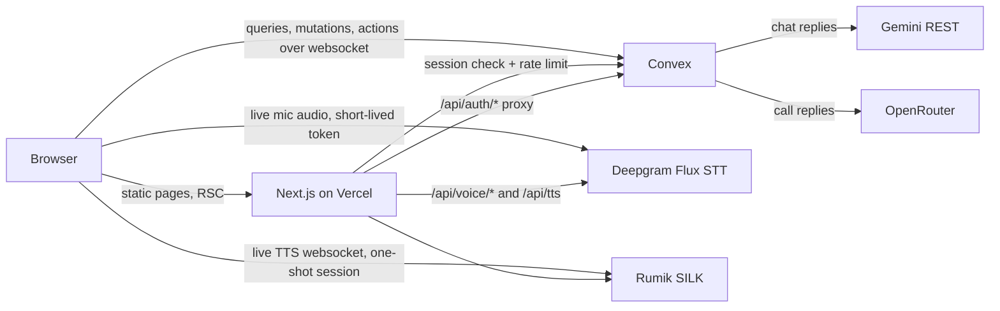
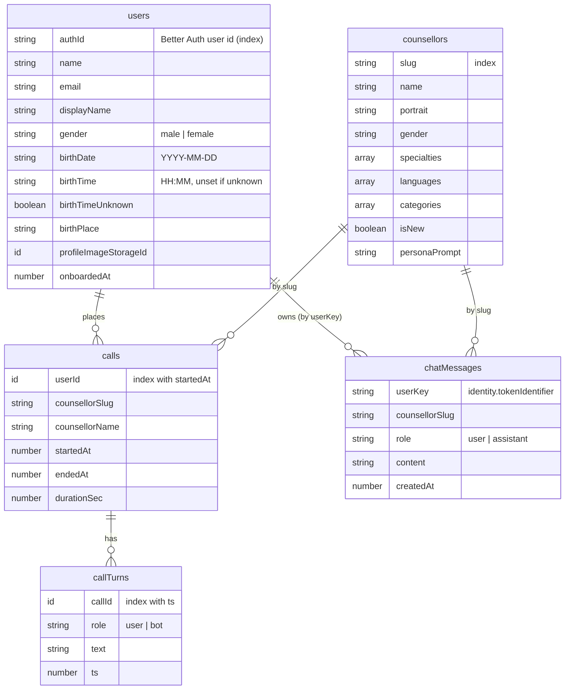
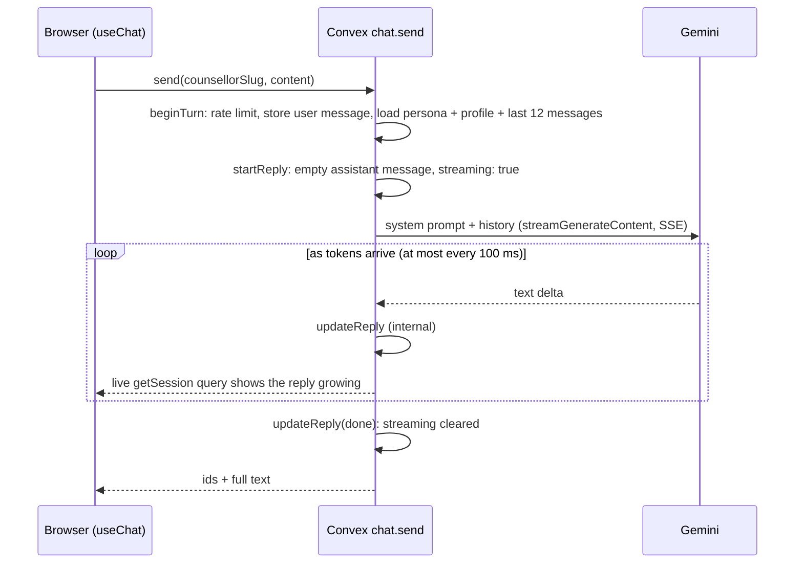

# Architecture

## System overview



- **Next.js** serves the public pages (prerendered at build time), the auth pages and the signed-in app under `/dashboard`. Its API routes only deal with speech and with proxying Better Auth to Convex.
- **Convex** holds all data, runs every LLM call, enforces ownership and rate limits, and hosts Better Auth (as a component) and the rate limiter (as a component).
- **The browser** connects directly to Convex, to Deepgram (with a 30 second token minted by `/api/voice/deepgram-token`) and to Rumik (with a one-shot session from `/api/voice/silk-mint`). It never holds a long-lived third-party key and never calls an LLM.
- `voice-agent/` is an optional Pipecat server for a fully server-side voice pipeline. The web app does not use it.

## Rendering and auth

| Route group | Rendering | Auth |
| --- | --- | --- |
| `app/(public)` (landing, `/astrologers`, `/astrologers/[slug]`, about, terms, privacy) | Static / SSG. Persona data comes from `lib/constants.ts` | None. Must not read cookies or headers |
| `app/(auth)` (sign-in, sign-up) | Static, `noindex` | `proxy.ts` sends signed-in visitors to `?next=` (sanitised by `safeNext`) or `/dashboard` |
| `app/(dashboard)` | Dynamic, `noindex` | `proxy.ts` does an optimistic cookie check; `layout.tsx` verifies the session with `isAuthenticated()` and wraps the tree in `ClientAuthBoundary` |

Better Auth runs inside Convex (`convex/auth.ts`, routes registered in `convex/http.ts`). The Next.js route `app/api/auth/[...all]` proxies to it, so the session cookie is first-party. `lib/auth-server.ts` exposes `isAuthenticated`, `fetchAuthQuery` and `fetchAuthMutation` for server components and route handlers. On the client, `UserSync` calls `user.ensureUser` once per session to create the app's `users` row.

## Data model



Source of truth: `convex/schema.ts`. Better Auth keeps its own user, session and account tables inside its component. Personas are defined in `lib/constants.ts` and copied into `counsellors` by `pnpm seed`; re-run it after editing a persona (`pnpm seed --prod` for production).

## Convex functions

| Module | Public | Internal |
| --- | --- | --- |
| `counsellors` | `list`, `getBySlug` (signed in only) | `seed` |
| `user` | `ensureUser`, `getProfile`, `saveProfile`, `generateProfileUploadUrl` | |
| `chat` | `getSession`, `listSessions`, `send` (action) | `beginTurn`, `startReply`, `updateReply`, `discardReply` |
| `calls` | `start`, `end`, `listMine`, `getMine`, `liveReply`, `respond` (action) | `beginTurn`, `startBotTurn`, `updateBotTurn`, `discardBotTurn` |
| `limits` | `consume` (used by Next.js API routes) | |
| `auth` | `getCurrentUser` | |

Helpers: `lib/users.ts` (identity and ownership), `lib/prompts.ts` (system prompts, built from the persona and the stored profile), `lib/llm.ts` (Gemini and OpenRouter over `fetch`), `lib/rateLimits.ts`.

### Rate limits (per user, token bucket)

| Name | Refill | Burst | Used by |
| --- | --- | --- | --- |
| `chatMessage` | 20 / min | 6 | `chat.send` |
| `voiceTurn` | 30 / min | 10 | `calls.respond` |
| `callStart` | 20 / hour | 5 | `/api/voice/deepgram-token` (one token per call) |
| `tts` | 40 / min | 12 | `/api/tts`, `/api/voice/silk-mint` |
| `stt` | 20 / min | 6 | `/api/voice/transcribe` (voice notes) |

## Main flows

### Text chat



Replies stream: the action creates an empty assistant message and patches it as Gemini's server-sent events arrive, so the chat shows the reply as it is written. If generation fails the empty message is deleted. Only the action (through internal mutations) writes assistant messages.

Voice notes: the browser records with MediaRecorder, posts the audio to `/api/voice/transcribe` (Deepgram, pre-recorded) and sends the transcript through `chat.send`. Assistant replies are always shown as text; each has a small read-aloud button, and the header speaker toggle (off by default) plays new replies automatically. Audio is synthesised only on request, by `/api/tts`.

### Voice call

```mermaid
sequenceDiagram
  participant B as Browser (useVoiceCall)
  participant N as Next.js API
  participant D as Deepgram Flux
  participant C as Convex
  participant R as Rumik SILK
  B->>C: calls.start
  B->>N: POST /api/voice/deepgram-token (callStart limit)
  N-->>B: 30 s token
  B->>D: websocket, PCM16 mic audio
  D-->>B: EndOfTurn + transcript
  B->>C: calls.respond(callId, text, turnKey)
  C->>C: beginTurn, build prompt, startBotTurn (empty, streaming)
  C->>C: stream OpenRouter, updateBotTurn every 60 ms
  C-->>B: calls.liveReply(callId, turnKey) shows the reply growing
  loop each batch of complete sentences
    B->>N: POST /api/voice/silk-mint (starts at once, overlaps playback)
    N-->>B: one-shot ws_url
    B->>R: stream that piece's audio, queued after the previous piece
  end
  Note over B: captions add each piece when its audio starts; speaking over the reply stops it (barge-in)
  B->>C: calls.end
```

The persona greets first: `calls.respond` with `kickoff: true` asks for a greeting that is not stored as a user turn.

The call speaks as soon as the first sentence is complete instead of waiting for the whole reply. `useVoiceCall` cuts the streamed text at sentence ends (not after abbreviations like "Pt.", and not before 20 characters), mints a Rumik session per piece straight away, and plays the pieces strictly in order on one Web Audio timeline. The rest of the reply is sent when the bot turn is marked done.

## Security

- Headers and CSP live in `next.config.ts`. `connect-src` lists Convex, `wss://api.deepgram.com` and the Rumik hosts. The CSP is applied to production builds only (dev needs `eval`).
- `script-src` allows `'unsafe-inline'` because a nonce would make every page dynamic (see DECISIONS.md).
- API routes call `guardRequest()` (`lib/api-guard.ts`): session check, then a Convex rate-limit mutation, then the third-party call.
- `user.saveProfile` only accepts a profile photo storage id that points at an image of at most 8 MB and that no other user has claimed (index `by_profileImageStorageId`), so one user cannot take over or delete another user's file.

## Environment variables

| Variable | Where | Required | Purpose |
| --- | --- | --- | --- |
| `CONVEX_DEPLOYMENT` | `.env.local` | dev | Written by `npx convex dev` |
| `NEXT_PUBLIC_CONVEX_URL` | `.env.local`, Vercel | yes | Convex client URL |
| `NEXT_PUBLIC_CONVEX_SITE_URL` | `.env.local`, Vercel | yes | Convex HTTP actions URL (auth proxy) |
| `NEXT_PUBLIC_SITE_URL` | `.env.local`, Vercel | production | Public origin for canonical URLs, OG, sitemap, robots. Falls back to `VERCEL_PROJECT_PRODUCTION_URL`, then localhost |
| `DEEPGRAM_API_KEY` | `.env.local`, Vercel | for voice | Deepgram key with Member permissions (mints temporary tokens) |
| `SILK_API_KEY` | `.env.local`, Vercel | for voice | Rumik TTS |
| `SILK_BASE_URL` | `.env.local`, Vercel | no | Default `https://silk-api.rumik.ai`; also feeds the CSP |
| `SILK_MODEL` | `.env.local`, Vercel | no | `muga` (default) or `mulberry` for female personas |
| `SITE_URL` (or `BETTER_AUTH_URL`) | Convex | yes | App origin for Better Auth |
| `BETTER_AUTH_SECRET` | Convex | yes | Session signing secret |
| `GEMINI_API_KEY` (or `GOOGLE_API_KEY`) | Convex | for chat | Gemini |
| `GOOGLE_CHAT_MODEL` | Convex | no | Default `gemini-3.5-flash` (2.5 Flash returns 404 for newer API projects). Thinking is turned off so it cannot eat the 360-token reply budget |
| `OPENROUTER_API_KEY` | Convex | for calls | OpenRouter |
| `OPENROUTER_MODEL` | Convex | no | Default `google/gemini-3.1-flash-lite-preview` |
| `GEMINI_API_KEY` | `.env.local` | scripts | Only for `pnpm generate:portraits` |

`voice-agent/server/.env.example` lists the Pipecat server's own variables.

`CONVEX_SITE_URL` is not needed in Next.js: `lib/auth-server.ts` passes `NEXT_PUBLIC_CONVEX_SITE_URL` to Better Auth explicitly, and Convex sets `CONVEX_SITE_URL` itself inside its runtime.

## Deployment

| Part | Where | How it ships |
| --- | --- | --- |
| Web app | Vercel project `kosmo` (Hobby), https://kosmo-ai.vercel.app | Every push to `main` builds and deploys (`pnpm build`). Vercel does not touch Convex. |
| Backend | Convex production deployment `graceful-elephant-326` | Manually: `npx convex deploy` after any change under `convex/` (functions, schema, indexes). |
| Personas | Convex `counsellors` table | `pnpm seed --prod` after editing `lib/constants.ts` (runs the internal mutation `counsellors:seed`). |
| Dev backend | Convex dev deployment `wry-wolverine-89` | `pnpm dev` / `pnpm dev:convex` push on save; `pnpm seed` seeds it. |

Ship backend changes before or together with the web change that depends on them: deploy Convex first, then push to `main`.
